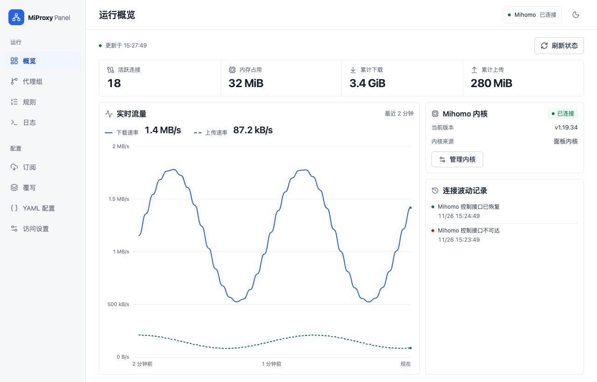
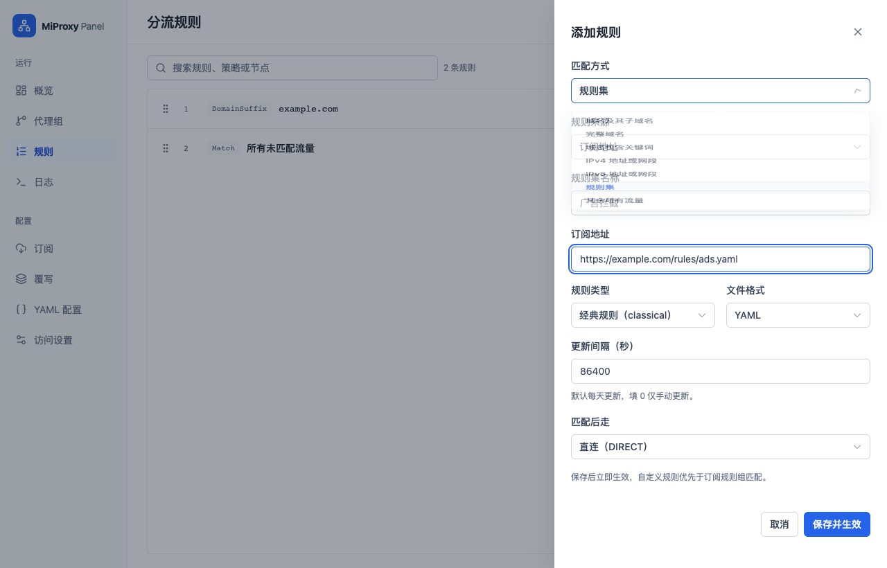

# MiProxy Panel

通过 Web 和终端管理 Mihomo 的轻量面板。Go 服务内嵌 Vue 前端，原生安装无需 Node.js 或 Go，SSH 中输入 `miproxy` 即可打开终端面板。

项目地址：[MaoLikeQvQ/MiProxy-Panel](https://github.com/MaoLikeQvQ/MiProxy-Panel) · [下载版本](https://github.com/MaoLikeQvQ/MiProxy-Panel/releases) · [问题反馈](https://github.com/MaoLikeQvQ/MiProxy-Panel/issues)

[完整使用说明](docs/usage.md) · [下载文件与适用环境](docs/downloads.md) · [v0.1.1 更新内容](docs/releases/v0.1.1.md) · [配置说明](docs/configuration.md)

## 界面预览

截图使用独立演示数据，不包含私人订阅或密钥。终端界面来自真实程序的伪终端输出。

Web 运行概览：

统一规则列表与规则集地址设置：

SSH / 本机终端订阅管理：

## 功能

- 导入 Clash / Mihomo 订阅链接或本地 YAML，更新、删除并切换订阅，查看流量与到期信息。
- 检测本机已有内核，或下载、校验并运行面板管理的 Mihomo。
- 查看代理组、切换节点、测速，管理分流规则、远程规则集和 YAML 覆写。
- 查看运行指标、流量历史和实时日志，支持桌面与手机 Web 界面。
- 终端管理服务启停、开机启动、订阅、节点、内核、更新和卸载。
- 从本项目 GitHub Releases 更新面板；正式产物由 GitHub Actions 构建。

面板启动 Mihomo 代理服务。透明代理、系统代理和路由器流量接管需要按设备配置，第一版不会自动接管网络。接入 ShellCrash / OpenClash 等外部内核时，原服务继续管理其进程和源配置。

## Linux / OpenWrt 直接安装

需要 root 权限、可访问 GitHub Releases 的网络，以及 `curl`、CA 证书、`tar` 和 SHA-256 工具。支持 systemd Linux 与 OpenWrt procd；旧路由器应核对架构和固件兼容性。

Debian / Ubuntu 可先安装下载工具：

~~~sh
sudo apt-get update
sudo apt-get install -y curl ca-certificates
~~~

下载并运行安装脚本：

~~~sh
curl -fL https://github.com/MaoLikeQvQ/MiProxy-Panel/releases/latest/download/install.sh -o /tmp/miproxy-install.sh
sudo sh /tmp/miproxy-install.sh
sudo miproxy
~~~

OpenWrt 在 root SSH 中执行相同命令，去掉 `sudo`；缺少工具时先安装 `curl` 和 `ca-bundle`。固件使用的包管理器可能为 `opkg` 或 `apk`。

安装器识别系统和架构，固定正式版本后下载二进制和部署包，校验 SHA-256 与版本号，再安装系统服务和 `miproxy` 命令，开启开机启动。不会在设备上编译。重复安装保留已有环境文件、配置和兼容的服务定义。

~~~sh
# 指定已发布版本
sudo sh /tmp/miproxy-install.sh --version v0.1.0
# 只安装，不立即启动服务
sudo sh /tmp/miproxy-install.sh --no-start
# 自动检测不适用时明确指定架构
sudo sh /tmp/miproxy-install.sh --arch armv7
~~~

安装脚本从正式 Release 下载并校验文件。手动选包、macOS 运行方式和各架构的对应关系见[下载文件与适用环境](docs/downloads.md)。

| 你的环境 | 建议文件或方式 |
| --- | --- |
| x86-64 Linux 服务器、软路由、NAS | `miproxy-panel_linux_amd64`；完整 systemd 系统优先使用在线安装器 |
| ARM64 Linux、64 位 ARM OpenWrt、64 位系统的树莓派 | `miproxy-panel_linux_arm64` |
| 32 位 ARM、MIPS 等 OpenWrt 路由器 | 按 CPU、用户空间位数和字节序选择；见[全部 13 个目标的对照表](docs/downloads.md#二进制文件) |
| Apple 芯片 Mac | `miproxy-panel_darwin_arm64`，命令行运行 |
| Intel Mac | `miproxy-panel_darwin_amd64`，命令行运行 |
| Docker / NAS 容器 | 使用仓库 Compose 从源码构建；原生安装脚本需要 systemd 或 procd |

二进制已内嵌 Web 页面和终端界面，无需安装 Node.js / Go。Mihomo 内核单独检测或下载，不包含在面板二进制中。`deploy.tar.gz` 是 Linux / OpenWrt 部署配套文件，不能单独运行；`checksums.txt` 用于校验。Release 同时提供 `downloads.md` 与 `usage.md`，可下载后离线查阅。当前不提供 Windows、`.app` / `.dmg`、`.deb` / `.rpm` 或 OpenWrt `.ipk` / `.apk` 安装包。

OpenWrt procd 适配和安装暂存测试不等同于路由器真机验收。已完成和未完成的验证见[第一版验收记录](docs/testing.md)。

### 离线安装

从同一 Release 下载对应二进制、`deploy.tar.gz`、`checksums.txt`，校验后解压安装。例如 Linux ARM64：

~~~sh
awk '$2 == "miproxy-panel_linux_arm64" || $2 == "deploy.tar.gz"' checksums.txt | sha256sum -c -
tar -xzf deploy.tar.gz
chmod +x miproxy-panel_linux_arm64
sudo sh deploy/install.sh --binary "$PWD/miproxy-panel_linux_arm64"
sudo miproxy
~~~

## 本次版本更新

v0.1.1 完成工程目录整理，拆分服务端、终端和共享模块，前端按业务功能组织；新增应用内访问设置，取消密码环境变量，并补充截图、使用与体积说明。完整变化和从 v0.1.0 升级的认证迁移步骤见[版本说明](docs/releases/v0.1.1.md)。

升级前使用 PANEL_PASSWORD 的部署，请先准备本机或 SSH 访问。升级后通过「访问设置」或设备终端 miproxy-panel access 设置新密码；旧密码环境变量不再生效。内核控制密钥从扫描结果或实际 YAML 自动取得。

## 首次使用

1. 执行 `miproxy` 打开终端，进入「Mihomo 内核」检测已有内核或安装并启动。
2. 进入「订阅管理」，按 `a` 导入链接，或 `f` 导入设备上的 YAML。
3. 用方向键选中订阅，按 `Enter` 确认切换应用。订阅自带的规则自动收纳为「订阅规则」组，保留原顺序和各条策略；校验与重载成功后显示 `[使用中]`。
4. 进入「代理组与节点」，选择代理组后切换节点或测速。自动选择组只能查看状态。

未导入订阅时，初始配置全部直连。导入支持不超过 2 MiB 的单份 UTF-8 Clash / Mihomo YAML，不能直接导入不含节点或代理集合的其他格式。

## 使用说明

### 打开面板和选择功能

安装完成后，在设备本机或 SSH 中执行：

~~~sh
sudo miproxy
~~~

已经是 root 用户时直接执行 `miproxy`。使用 `↑` / `↓` 选择左侧菜单，按 `Enter` 进入右侧内容；也可按数字直接进入：

| 数字 | 页面 | 常用操作 |
| --- | --- | --- |
| `1` | 运行概览 | 查看面板与内核连接、流量和连接数 |
| `2` | 服务管理 | 启动/停止、重启、开启/关闭开机启动 |
| `3` | 订阅管理 | 导入、更新、删除、切换应用订阅 |
| `4` | 代理组与节点 | 进入代理组、切换节点、测速 |
| `5` | Mihomo 内核 | 检测已有内核、安装或启动、切换接入方式 |
| `6` | 日志与诊断 | 查看连接检查结果与实时日志 |
| `7` | 更新与卸载 | 从 GitHub 更新面板、更新内核或卸载 |

`Tab` 切换菜单与内容的操作焦点，`Esc` 返回；涉及停止服务、切换配置或删除的操作会显示确认说明，按 `y` 执行，按 `n` 或 `Esc` 取消。

### 安装或连接 Mihomo

1. 按 `5` 进入「Mihomo 内核」，按 `d` 检测本机已有内核。
2. 找到可用内核时，用方向键选中后按 `Enter`，按 `y` 确认接入。未运行的二进制会使用面板自己的配置启动；已有外部服务继续由原应用管理。
3. 没有可用内核时，按 `i`，按 `y` 确认安装并启动。页面显示下载、校验和连接状态。
4. 等待显示「已连接」，再导入并应用订阅。需要从外部内核恢复到面板内核时，先按 `p` 确认恢复，再按 `i` 启动。

### 导入、切换和删除订阅

按 `3` 进入「订阅管理」，按以下方式操作：

- **导入链接**：按 `a`，输入订阅名称后回车，再粘贴订阅链接并回车。链接输入隐藏，导入成功后出现在列表中。
- **导入文件**：先将 YAML 文件放到运行面板的设备上，按 `f`，依次输入名称和文件绝对路径，例如 `/root/subscription.yaml`。
- **切换应用**：用 `↑` / `↓` 选中订阅，按 `Enter` 或 `s`，检查确认说明后按 `y`。等待校验和重载完成，成功后该项显示 `[使用中]`。`›` 只表示当前选中，不表示已经应用。
- **更新订阅**：选中远程订阅后按 `u` 下载最新内容，再按 `Enter` 重新应用。本地文件订阅通过 `f` 重新导入。
- **删除订阅**：选中后按 `d`，按 `y` 确认。删除仅移除订阅记录，当前运行配置继续有效；需要更换配置时再应用其他订阅。

如果显示「配置已保存，但内核重载失败」，先检查内核连接和日志，再重新应用；不要将「已保存」当作切换成功。外部应用管理的配置需要在原应用中应用订阅。

### 切换节点和测速

1. 按 `4` 进入「代理组与节点」，用方向键选择代理组，按 `Enter` 查看节点。
2. 在手动选择组中选中节点，按 `Enter` 立即切换，当前节点会显示「当前选择」。
3. 按 `t` 测试本组节点延迟；按 `g` 返回代理组列表。自动选择组由内核决定节点，不能手动切换。

### 服务启停和开机启动

按 `2` 进入「服务管理」。面板运行时第一项显示「停止面板服务」，停止后同一项显示「启动面板服务」；开机启动也在同一项中切换「开启」和「关闭」。选中操作后按 `Enter`，检查影响范围后按 `y`。重启为独立操作项。

停止面板会同时停止它启动的 Mihomo，代理连接可能中断。终端菜单仍然可用，可以再次启动服务。按 `q` 退出菜单只返回命令行，不会停止服务。

### 查看日志和排查问题

按 `6` 查看连接诊断和内核实时日志，按 `l` 查看系统中的面板服务日志；用方向键或翻页键滚动，按 `Esc` 返回。内核未连接时不会请求内核日志。

| 现象 | 处理方式 |
| --- | --- |
| 面板服务未连接 | 在「服务管理」启动；自定义部署检查终端与服务的 `PANEL_CONFIG` / `PANEL_SOCKET` 是否一致 |
| Mihomo 未连接 | 在「Mihomo 内核」检测或启动；外部内核到原应用检查接口 |
| 导入或下载失败 | 检查网络、订阅格式及链接有效期，根据页面提示重试 |
| GitHub 限流或没有正式 Release | 稍后重试，或确认仓库已发布该版本；当前程序保持不变 |
| 字太小或画面偏移 | 在终端软件中调大字号，按 `Ctrl+L` 重绘或重新进入面板 |

### 更新和卸载

按 `7`，选择「检查并更新面板（GitHub）」后回车。发现新版本时先核对版本与影响说明，再按 `y` 下载更新；更新完成后退出并重新运行 `miproxy`。Mihomo 更新为同页的独立选项。

需要卸载时选中「卸载面板与命令」，按 `Enter`，阅读说明后按 `y`。卸载后终端退出，面板服务与命令被移除，配置、环境文件和内核文件保留。

### 终端操作

终端无需登录用户名和密码，通过只有服务用户和 root 可访问的本机 Unix Socket 连接后台。系统服务管理、更新和卸载需要 root。退出终端不会停止后台服务。

| 按键 | 操作 |
| --- | --- |
| `↑` / `↓`、`Enter` | 选择、进入或执行 |
| `Tab`、`Esc` | 切换菜单/内容焦点、返回 |
| `1`–`7` | 进入对应菜单 |
| `q` / `0` | 退出；表单中的字符按普通输入处理 |
| `Ctrl+L` | 清屏重绘，保留正在输入的内容 |
| 订阅页 `a` / `f` / `u` / `d` | 导入链接 / 导入文件 / 更新 / 删除 |
| 节点页 `t` / `g` | 本组测速 / 返回代理组 |
| 内核页 `d` / `i` / `p` | 检测 / 安装或启动 / 恢复面板内核 |

服务页的启停与开机启动各只有一个操作项，随当前状态切换文字。最小窗口为 40 列 × 16 行，窄于 94 列切换单栏；`NO_COLOR=1 miproxy` 使用无彩色界面。字号由终端软件控制，macOS 终端可用 ⌘ + `+` 放大。

### Web 面板

原生安装默认监听 `127.0.0.1:8787`，在设备本机打开 [http://127.0.0.1:8787](http://127.0.0.1:8787)。远程服务器可以使用 SSH 转发：

~~~sh
ssh -L 8787:127.0.0.1:8787 用户名@设备地址
~~~

然后在自己电脑浏览器打开同一地址。默认回环访问无需登录。需要直接开放局域网访问时，先在 Web「访问设置」中设置密码，再配置监听地址；Web 登录用户名为 admin。也可在设备终端执行 miproxy-panel access 设置或恢复密码。终端不受 Web 登录设置影响。完整变量见[配置说明](docs/configuration.md)。

Web 的基本使用流程：

1. 未连接内核时，在「内核管理」对话框中选择已有内核，或点击「安装并连接」；之后也可从概览页的「管理内核」重新打开。
2. 打开「订阅」，点击「导入订阅」，选择链接或本地 YAML，填写名称并导入。对目标订阅点击「应用订阅」：面板自动合并节点、代理组及规则，将订阅自带的规则收纳为「订阅规则」组，再校验、保存并重载内核。等待全局加载结束并确认应用成功。仅导入不会更改当前规则；更新按钮也只下载最新内容，需要再次应用才生效。更多操作中可以移除订阅。
3. 打开代理组的「运行状态」切换节点和测速；「配置编辑」用于修改代理组配置。
4. 在「规则」中统一查看生效规则、匹配顺序和当前策略；点击订阅规则组行内的规则数量展开内容。刷新旁的「添加规则」直接打开添加弹窗；匹配方式选择「规则集」后，可填写订阅地址、规则类型、文件格式和更新间隔，也可引用已有规则集，支持编辑、删除和排序当前配置中的规则。新增自定义规则默认放在订阅规则组之前；长期保留的自定义规则可写入覆写中的 `prepend-rules`。YAML 和覆写草稿需要点击「保存并应用」；规则表单的「保存并生效」会直接校验并应用。
5. 在概览查看实时指标，在日志页查看内核日志。YAML 编辑器支持 Ctrl/⌘ + F 搜索和 Ctrl/⌘ + S 保存。

## 更新与卸载

在 `miproxy` 的「更新与卸载」中检查 GitHub 正式版本。显示版本号后确认，程序自动下载对应架构文件，核对 SHA-256 和程序版本号再替换；失败时保留或尝试恢复旧版本。更新面板会重启它管理的内核，完成后重新进入 `miproxy` 使用新版终端。

Mihomo 更新来自 MetaCubeX/mihomo 官方稳定版，外部应用的内核通过原应用更新。卸载会移除面板服务和命令，保留配置、环境文件与 Mihomo 文件，并停止面板启动的内核。更新与卸载仅适用于本安装脚本记录的安装。

## 配置行为

### 订阅规则自动收纳

Web 点击「应用订阅」或终端确认应用时，只要订阅包含非空的 `rules`，就会自动将其收纳成「订阅规则」组，无需达到规则数量阈值，也无需手动整理。例如订阅有 2,000 条规则，应用后主规则列表用一条引用表示这组规则；在「规则」列表中点击「订阅规则」行内的规则数量，仍可展开查看全部内容。

生成的配置结构如下：

~~~yaml
rules:
  - SUB-RULE,(OR,((NETWORK,TCP),(NETWORK,UDP))),订阅规则

sub-rules:
  订阅规则:
    - DOMAIN-SUFFIX,example.com,代理组
    - GEOIP,CN,DIRECT
    - MATCH,代理组
~~~

自动整理只改变规则的组织方式，原有规则、匹配顺序和各条策略保留，不会减少内核实际需要匹配的规则数量。「订阅规则」直接在统一规则列表中展示并展开，配置使用 Mihomo 的 `sub-rules` / `SUB-RULE`；远程规则集使用 `rule-providers` / `RULE-SET`，其引用指定统一策略，不能直接承载订阅中各不相同的分流策略。

以下情况需要区分：

- **仅导入或更新订阅**：保存订阅内容，应用后才会生成并启用规则组。
- **纯节点订阅**：不包含规则时保留当前分流配置，不额外生成规则组。
- **订阅已有同名子规则组**：自动使用「订阅规则 2」等名称，保留原组。
- **覆写直接设置 `rules`**：覆写在订阅整理后合并，普通列表整体替换；它可能覆盖主规则中的订阅组引用。需要前置自定义规则时使用 `prepend-rules`。
- **接入 Sparkle、ShellCrash、OpenClash 等外部内核**：运行规则展示原应用实际加载的配置，面板不会自动改写外部配置。看到大量平铺规则时，应先确认当前连接来源；面板的自动收纳作用于面板生成的订阅配置。

### 本地设置与覆写

完整订阅替换代理与分流字段，纯节点订阅只替换它提供的节点字段；本地端口、控制接口、密钥和 DNS 保留。订阅规则收纳后可叠加已保存的覆写。映射递归合并，普通列表整体替换；自定义前置规则使用：

~~~yaml
prepend-rules:
  - DOMAIN-SUFFIX,example.com,DIRECT
dns:
  enable: true
~~~

更新或删除订阅不会立即改变当前运行配置。应用前调用本机 Mihomo 校验，检查文件版本并原子保存，再请求重载；重载失败会显示「已保存但未应用」。沿用保存流程中的单份自动回退文件，不提供备份管理菜单。

下载使用现有代理环境变量；macOS 未配置环境代理时读取系统 HTTP/HTTPS 代理。需要缺少的 GeoIP / GeoSite / ASN 数据时先按需下载，失败则保留原配置。订阅链接和内核连接密钥保存在配置旁的 `0600` 文件中。

## Docker

仓库提供 Compose 示例，Mihomo 与面板共享配置目录。Docker 服务生命周期由 Docker 管理。

~~~sh
mkdir -p config
test -e config/config.yaml || cp deploy/config.example.yaml config/config.yaml
test -e .env || cp .env.example .env
chmod 600 .env
~~~

Docker 不再要求密码环境变量。内核密钥从共享 YAML 自动读取。启动后通过容器内私有控制接口设置 Web 密码：

~~~sh
docker compose up --build -d
docker compose exec panel /miproxy-panel access
~~~

默认访问 [http://127.0.0.1:8787](http://127.0.0.1:8787)，Web 用户名 `admin`。此 Compose 方式从源码构建；GitHub Release 提供原生二进制，第一版没有发布容器镜像到镜像仓库。

## 项目结构与开发

后端命令入口位于 cmd/miproxy-panel，服务端与终端分别位于 internal/server、internal/terminal；API 契约、配置合并、认证、文件和下载能力独立为内部模块。前端按业务功能放在 web/src/features，公共能力归 shared，测试分为 unit 与 browser。完整职责和依赖方向见[架构说明](docs/architecture.md)。

~~~sh
make build          # 构建 Web 和本机程序
make test           # Go 竞态测试 + 前端单元测试
make check          # 类型、Go vet、脚本语法
make test-browser   # 对已启动的 18788 预览执行回归
make dev            # 后端默认 8787
~~~

本次本地构建的实际体积：

| 环境 | 面板二进制 |
| --- | ---: |
| Linux amd64 | 9.61 MiB |
| Linux arm64 | 9.00 MiB |
| macOS Apple Silicon | 9.16 MiB |
| macOS Intel | 9.79 MiB |
| 其他目标 | 8.69–10.50 MiB |

全部架构及配套文件合计约 125.02 MiB，单台设备只下载一个架构。以本机现有 Mihomo v1.19.33 为例，面板与内核两个可执行文件共约 63.34 MiB，不含 Geo 数据、订阅缓存和 Sparkle 应用。

体积实测与复现命令见[安装包体积](docs/package-size.md)。面板二进制包含 Web 与终端；Mihomo、Geo 数据和订阅缓存另计。v0.1.1 的升级说明见版本记录；v0.1.0 保留原有行为。

## 开发与发布

正式打包在 GitHub Actions 的 Ubuntu 环境完成。手动预检只生成构建产物，版本标签触发正式发布；Linux 安装验收失败时不发布。见[GitHub 打包与发布流程](docs/releasing.md)。

本地开发需要 Go 1.26、Node.js 24：

~~~sh
npm --prefix web ci
npm --prefix web run build
go test -race ./...
go vet ./...
mkdir -p bin config
CGO_ENABLED=0 go build -trimpath -o bin/miproxy-panel ./cmd/miproxy-panel
ln -sf miproxy-panel bin/miproxy
~~~

一个终端运行 `./bin/miproxy-panel`，另一个终端运行 `./bin/miproxy`。终端读取 `/etc/miproxy-panel.env`，或用 `MIPROXY_ENV_FILE` 指定环境文件；显式环境变量优先。macOS 可以运行后台与终端界面，系统服务管理适配 Linux / OpenWrt。
